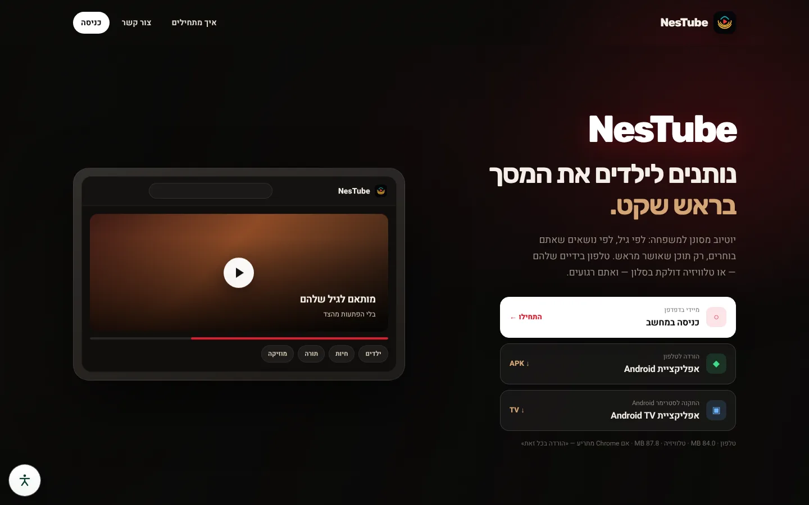
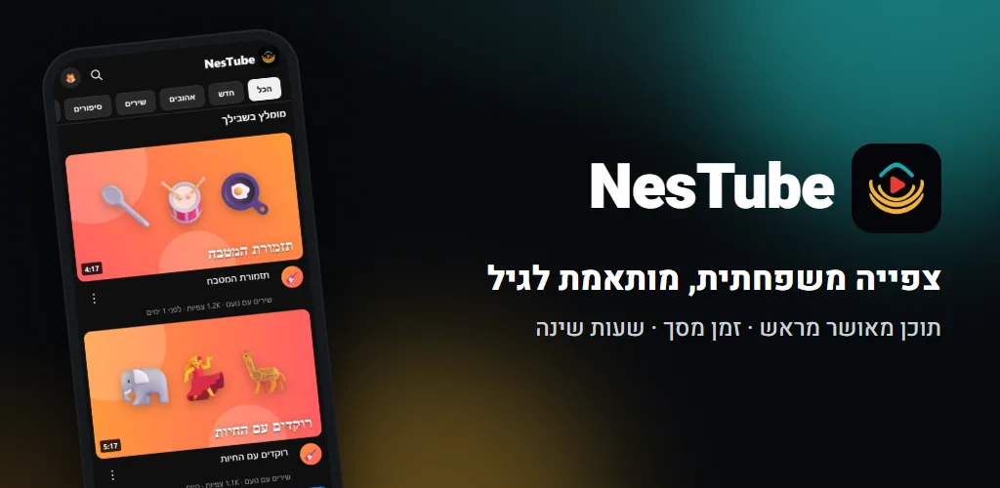
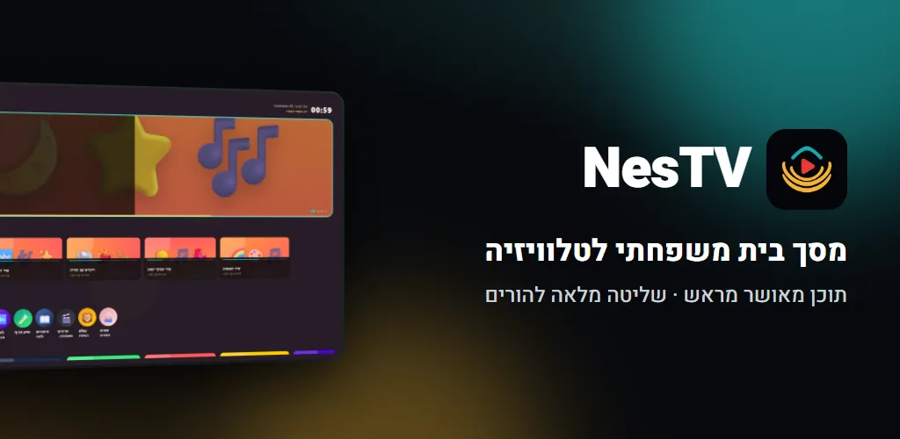
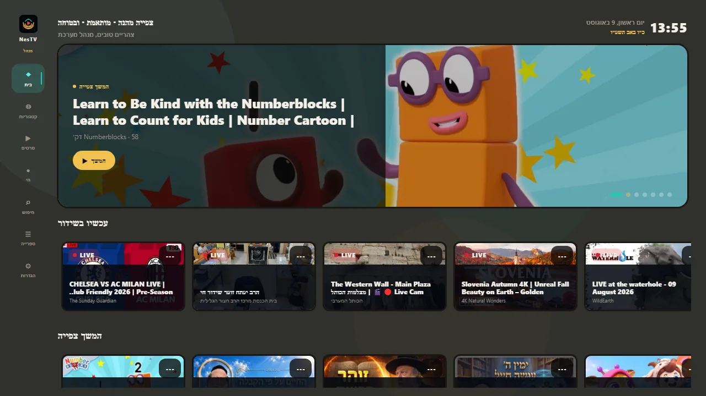
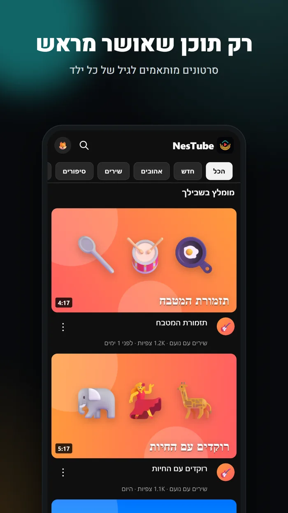
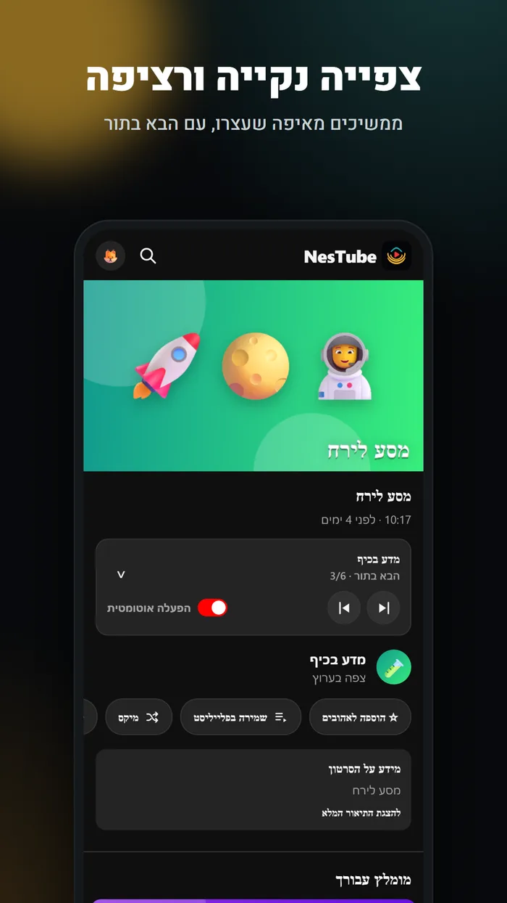
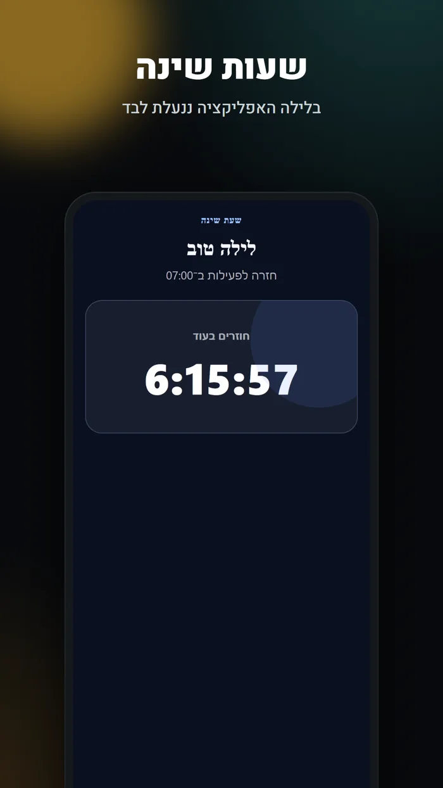

# NesTube & NesTV

**Filtered YouTube for families — only content parents approved in advance.**

Android & Android TV apps

 

## Overview

A family viewing platform: a phone app (NesTube), a TV and streamer app (NesTV) and a parent admin panel. Kids only see approved, age-appropriate channels and videos.

| The challenge | The solution |
| --- | --- |
| Parents can’t trust YouTube’s algorithm: Shorts, endless recommendations and unsuitable content appear even on kids’ accounts. | I built the full system: a server that syncs approved channels through the YouTube API, a parent admin panel, and two apps — for the phone and the living-room screen — that show only what was approved. |

## Key features

- Only pre-approved content, no Shorts or outside recommendations
- Age and interest matching, safe library and search
- Bedtime lock and screen-time controlled by parents
- Dedicated Android TV app with a remote-friendly UI

> **Outcome:** Android apps for phone and TV, with a download site and desktop sign-in.

## Tech stack

`Expo` `React Native` `Android TV` `React` `Fastify` `MySQL` `Redis` `YouTube API`

## Screenshots

  

  
  
  

## My role

Product spec, UX, full-stack development, deployment and ongoing support — built end-to-end by me under **[AZToDev](https://aztodev.com)**.

## About the code

This is a commercial product, so the source code is private. This repository is a public showcase. For a live demo or a technical walkthrough, reach out:

[aztodev.com](https://aztodev.com) · [LinkedIn](https://www.linkedin.com/in/zion-amar) · amzion24@gmail.com

---

### בעברית

**NesTube & NesTV** — יוטיוב מסונן למשפחה — רק תוכן שההורים אישרו מראש.

פלטפורמת צפייה משפחתית: אפליקציה לטלפון (NesTube), אפליקציה לטלוויזיה ולסטרימר (NesTV) ופאנל ניהול להורים. הילדים רואים רק ערוצים וסרטונים מאושרים, מותאמים לגיל.

